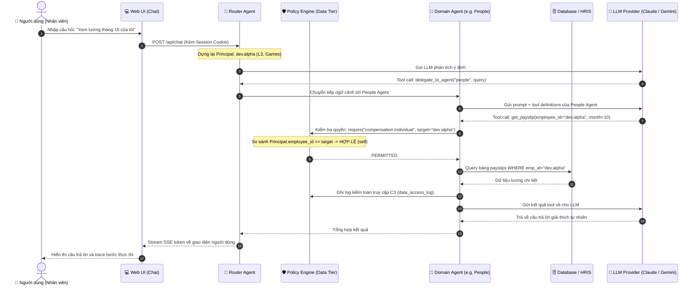
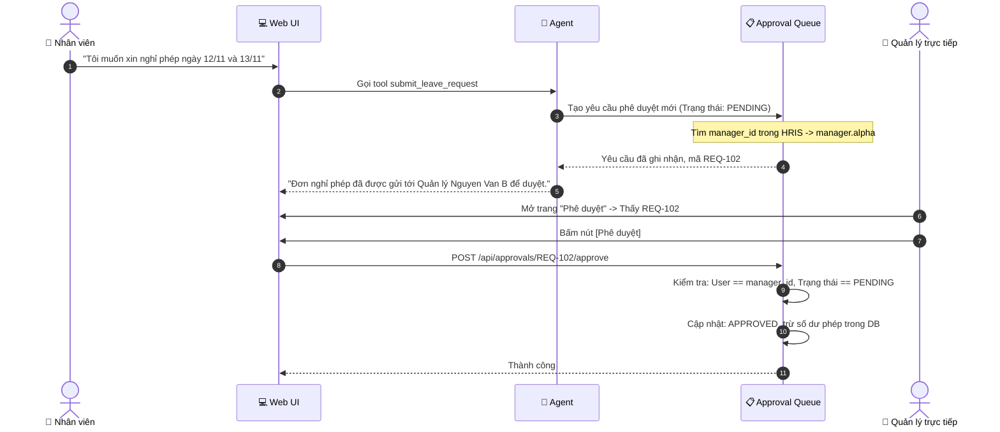

# User Flow & Interaction Diagrams

## Core User Flow: Asking a Question with Policy & Delegation

## Secondary Flow: Action with Approval Queue (Human-in-the-Loop)

## Assumptions & Open Questions
None. [Q1, Q2]
