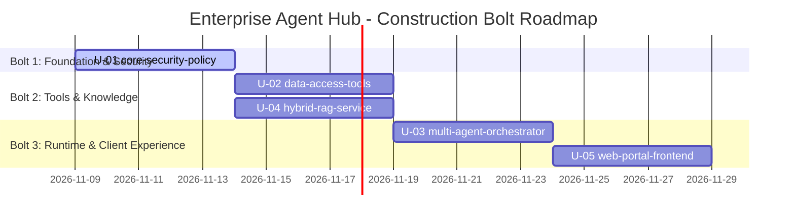

# Delivery Bolt Plan (Construction Sequencing)

## Bolt Structure Overview
Kế hoạch phân bổ Construction thành 3 đợt triển khai (Bolts) tuần tự theo nguyên tắc Risk-First & Topological Ordering:

---

## Bolt 1: Security Foundation & Policy Engine (Walking Skeleton)
- **Mục tiêu**: Xây dựng nền tảng bảo mật và phân quyền dữ liệu tuyệt đối trước khi xây dựng bất kỳ logic AI hay giao diện nào.
- **Units**:
  - `U-01: core-security-policy` (kind: `service`)
- **Key Capabilities Delivered**:
  - ABAC Policy Engine (`app/policy.py`) và nạp cấu hình `config/policies.yaml`.
  - Tái dựng danh tính `Principal` từ HRIS database ở mỗi request.
  - Thuật toán K-anonymity (k=3, k=5) và Complementary Suppression.
  - Bộ che mờ log cho dữ liệu C3 (`REDACTED_TOOL_OUTPUTS`).
  - Hệ thống ghi log kiểm toán `data_access_log`.
- **Checkpoint Criteria**: 100% test cases trong `tests/test_policy.py` pass.

---

## Bolt 2: Domain Tools & Vietnamese Hybrid RAG
- **Mục tiêu**: Cung cấp năng lực trích xuất dữ liệu có kiểu chặt chẽ và kho tri thức văn bản lai an toàn.
- **Units**:
  - `U-02: data-access-tools` (kind: `library`)
  - `U-04: hybrid-rag-service` (kind: `service`)
- **Key Capabilities Delivered**:
  - 16 Typed Pydantic tools cho Nhân sự, Lương, Phép, Báo cáo lãnh đạo, Tài chính, IT Helpdesk.
  - Pipeline tìm kiếm lai BM25 + FastEmbed Vector kết hợp RRF ranking.
  - Bộ lọc Document ACL phân quyền theo từng tài liệu.
  - Hàng đợi yêu cầu phê duyệt cho các thao tác thay đổi trạng thái.
- **Checkpoint Criteria**: Các công cụ thực thi đúng phân quyền, tìm kiếm RAG chính xác trích dẫn nguồn `[n]`.

---

## Bolt 3: Orchestration Runtime & Web Experience
- **Mục tiêu**: Tích hợp toàn diện mô hình AI đa agent, streaming thời gian thực và giao diện người dùng.
- **Units**:
  - `U-03: multi-agent-orchestrator` (kind: `service`)
  - `U-05: web-portal-frontend` (kind: `ui`)
- **Key Capabilities Delivered**:
  - Router Agent ("Trợ lý Sao Mai") và 5 Specialized Agents.
  - Streaming Server-Sent Events (SSE) kèm trace bước thực thi của agent.
  - Tầng adapter đa LLM (Claude, Gemini, OpenAI-compat, Ollama).
  - Web Portal 7 phân hệ hoàn chỉnh.
- **Checkpoint Criteria**: Toàn bộ 47 integration test cases vượt qua, trải nghiệm hội thoại streaming mượt mà.
