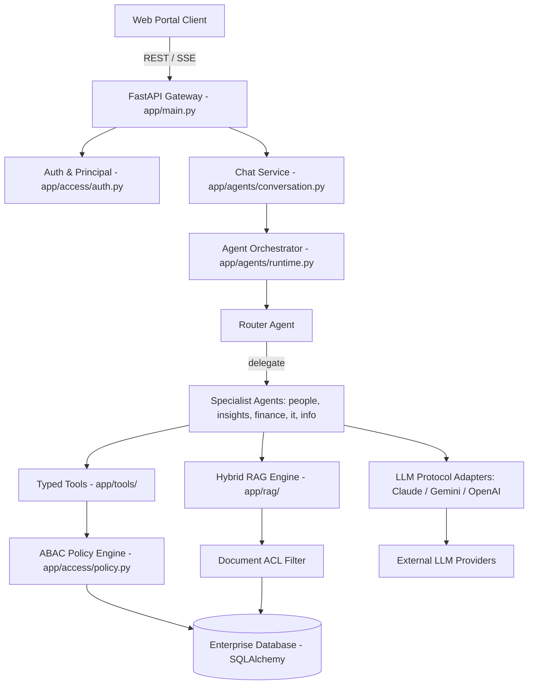

# Component Catalogue & Domain Design

## 1. Domain Architecture Diagram



## 2. Component Catalogue (YAML Specification)

```yaml
components:
  - id: core-auth
    name: Authentication & Principal Service
    package: app.auth
    kind: service
    description: Xác thực phiên đăng nhập, trích xuất và tái tạo Principal từ HRIS database ở mỗi request.
    dependencies: [core-db]
    interfaces:
      - get_current_principal(request) -> Principal
      - get_db_session() -> Session

  - id: security-policy
    name: ABAC Policy Engine
    package: app.policy
    kind: service
    description: Bộ máy thực thi chính sách phân quyền dữ liệu tập trung, k-anonymity và log kiểm toán.
    dependencies: [core-db, core-auth]
    interfaces:
      - policy.require(principal, resource, target_id) -> bool
      - policy.scope(principal, resource) -> ScopeCriteria
      - policy.log_access(principal, resource, target_id, action)

  - id: agent-orchestrator
    name: Multi-Agent Orchestrator & Runtime
    package: app.orchestrator
    kind: service
    description: Quản lý vòng đời agent, gọi hàm (tool use), streaming SSE, và điều phối router delegation.
    dependencies: [llm-adapters, security-policy, tool-registry]
    interfaces:
      - runtime.chat(agent_id, messages, principal) -> AsyncGenerator[Event]
      - runtime.delegate(from_agent, to_agent, task)

  - id: hybrid-rag
    name: Vietnamese Hybrid RAG Service
    package: app.rag.service
    kind: service
    description: Tìm kiếm lai BM25 + Embeddings với bộ lọc bảo mật ACL từng tài liệu và trộn kết quả RRF.
    dependencies: [core-db, security-policy]
    interfaces:
      - rag_service.search(query, kb_id, principal, top_k=5) -> List[SearchResult]
      - rag_service.index_document(doc_path, kb_id, metadata)

  - id: typed-tools
    name: Pydantic Business Tools Suite
    package: app.tools
    kind: library
    description: Tập hợp 16 công cụ nghiệp vụ gõ kiểu chặt chẽ cho HR, Lương, Phép, Analytics, Workflow.
    dependencies: [security-policy, core-db]
    interfaces:
      - PeopleTools (get_payslip, get_leave_balance, submit_leave_request, ...)
      - AnalyticsTools (workforce_analytics, budget_report)
      - WorkflowTools (submit_expense_claim, create_ticket)

  - id: llm-adapters
    name: Multi-Provider LLM Protocol Adapter
    package: app.providers
    kind: library
    description: Chuẩn hóa API của Claude, Gemini, OpenAI-compat và Ollama về định dạng Messages API thống nhất.
    dependencies: []
    interfaces:
      - get_client() -> LLMClient
      - LLMClient.create_message_stream(messages, tools, system)
```

## Assumptions & Open Questions
None.
