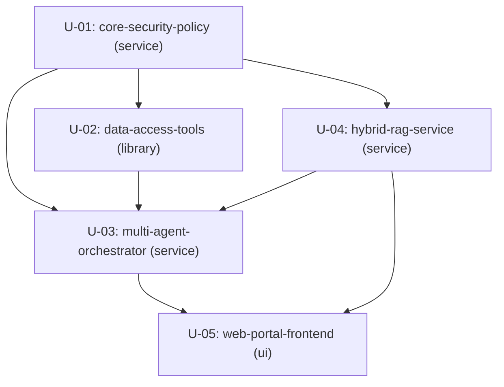

# Unit of Work Dependency DAG

## Dependency Graph (Topology)

## Dependency Declarations

- **U-01 (`core-security-policy`)**: Không phụ thuộc vào unit nào (Nền tảng bảo mật gốc).
- **U-02 (`data-access-tools`)**: Phụ thuộc `U-01` (Gọi `policy.require` và `policy.scope` trong từng tool).
- **U-04 (`hybrid-rag-service`)**: Phụ thuộc `U-01` (Kiểm tra Document ACL theo Principal).
- **U-03 (`multi-agent-orchestrator`)**: Phụ thuộc `U-01`, `U-02`, `U-04` (Điều phối việc gọi tools và RAG search).
- **U-05 (`web-portal-frontend`)**: Phụ thuộc `U-03`, `U-04` (Giao tiếp qua REST API và SSE streams).
